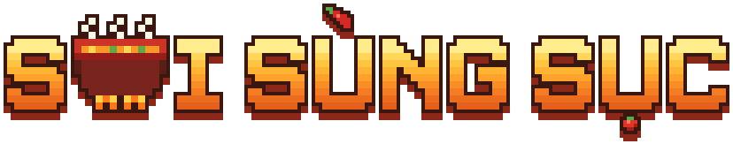
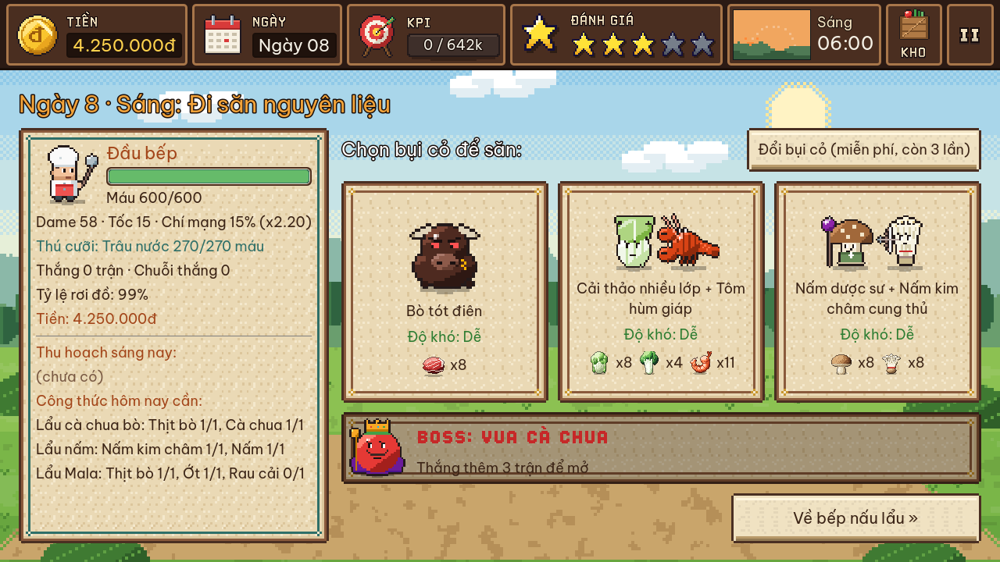
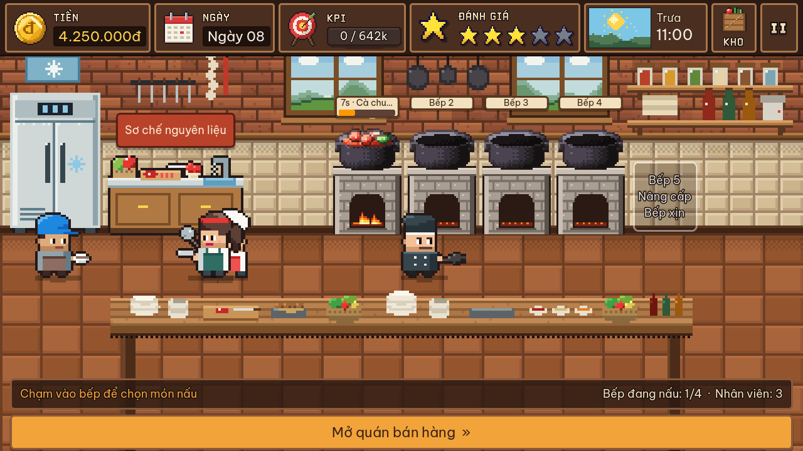
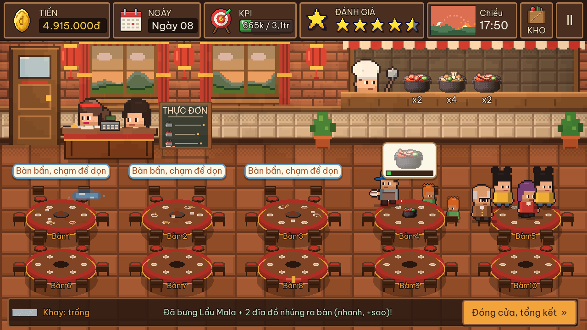
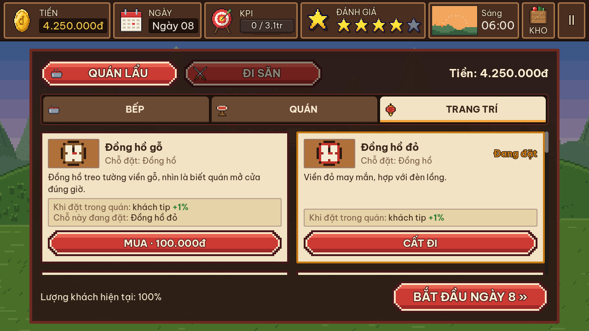
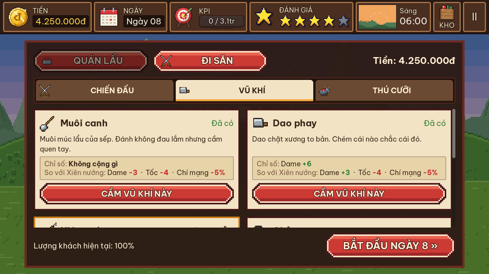
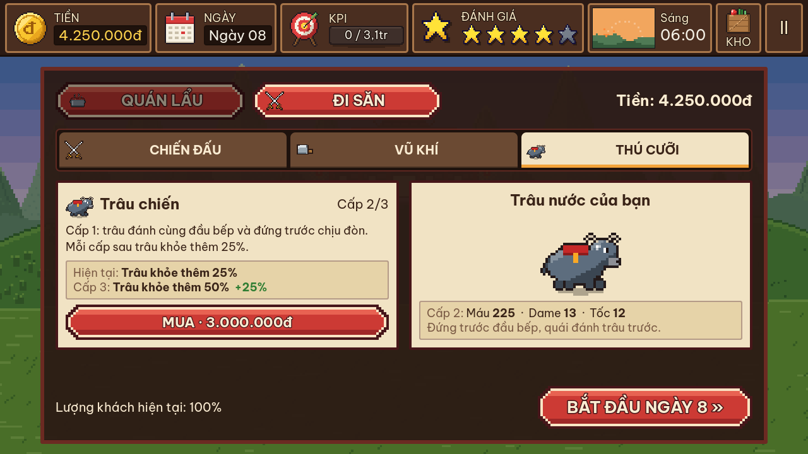
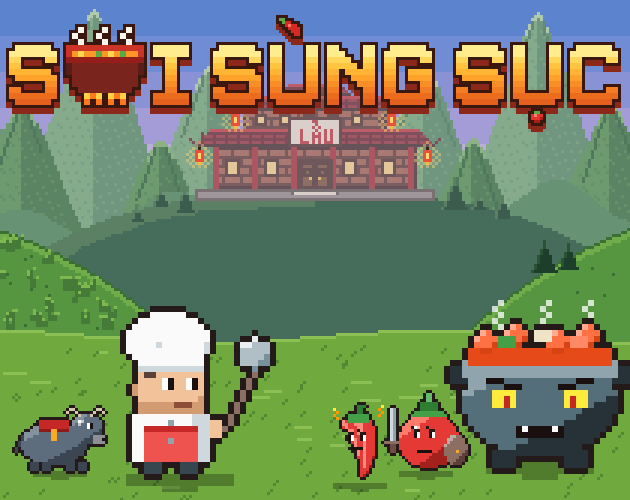

<div align="center">



**Săn nguyên liệu bằng đánh theo lượt · Nấu lẩu · Bán cho khách · Đạt KPI mỗi ngày**

[](https://znoywho.itch.io/soi-sung-suc)
<br>


<br>


<br>


</div>

## Giới thiệu

**Sôi Sùng Sục** là game 2D pixel về một quán lẩu trên đỉnh núi. Mỗi ngày gồm 3 buổi:

| Buổi | Việc cần làm |
|---|---|
| **Sáng · Đi săn** (2:30) | Chọn bụi cỏ, đánh quái rau củ theo lượt để lấy nguyên liệu; đủ trận thì mở Boss |
| **Trưa · Nấu** (2:30) | Sơ chế nguyên liệu bằng mini-game, nấu nước cốt trên nhiều bếp (1 bộ nguyên liệu = 1 phần lẩu) |
| **Chiều tối · Bán** (3:15) | Xếp khách vào bàn, bưng lẩu, dọn bàn và sàn, giữ sao đánh giá |

Cuối ngày tổng kết **KPI**: không đạt là thua, đạt thì vào **cửa hàng** rồi sang ngày mới — KPI tăng dần theo doanh thu.
Chơi được bằng chuột trên máy tính và **cảm ứng trên điện thoại** (màn ngang).

## Tính năng

- **Đánh theo lượt (ATB theo tốc độ):** 20 loại quái rau củ có nội tại riêng (độc, nổ, hồi máu, cuộn tròn…), Boss rơi **nguyên liệu hoàng kim** giá gấp 3, chế độ Tự đánh và tua x2.
- **Sơ chế bằng thao tác chạm / kéo** (rửa, thái, lột, lăn viên, xiên…): mỗi bước một ô màu, cuối lượt ra **Kém / Thường / Thượng hạng** với huy chương và chữ pixel riêng. Thượng hạng nấu nước cốt nhanh hơn 15%, đồ nhúng bán đắt hơn 20%; Kém chậm hơn 10%, rẻ hơn 15%.
- **Cửa hàng 2 nhóm:**
  - **Quán lẩu:** Bếp (nồi, bếp, nhân viên, kho lạnh) · Quán (nội thất, thêm bàn, phí phục vụ) · **Trang trí**
  - **Đi săn:** Chiến đấu (dao, giáp, chí mạng, Long đao, Chiến bào) · **Vũ khí** · **Thú cưỡi**
- **Vũ khí:** Muôi canh, Dao phay, Xiên nướng, Chảo gang, Dao bầu hoàng kim — mua một lần, chọn 1 cái để cầm, mỗi món một kiểu (mạnh, nhanh, chí mạng).
- **Thú cưỡi:** Trâu nước đánh cùng đầu bếp và đứng trước chịu đòn, mạnh dần theo cấp.
- **Trang trí quán:** 17 món cho 6 chỗ (đồng hồ, tranh, kệ, mèo thần tài, góc quán, trên cửa), đặt món nào thấy món đó trong quán, mỗi món cộng tip.
- **Quán sống động:** nhóm khách 1–6 người, bàn tròn 6 ghế, sự kiện khách đặc biệt, dọn bàn / quét rác / lau sàn, mặc cả khi hết món, **bảng Khách đang chờ** cạnh phải (từng nhóm, thanh kiên nhẫn, số bàn chờ món / đang ăn).
- **Lưu tự động** sau mỗi ngày, bảng **Cách chơi** lần đầu vào mỗi buổi, **chuyển cảnh** có thẻ tên buổi, mốc ngày 5/10/15 quái mạnh hơn.
- **Độ khó tăng dần cho người mới:** ngày 1 khách tới thưa (12 giây một nhóm), mỗi ngày dày thêm, từ ngày 5 là 6 giây một nhóm; hết sạch lẩu thì quán tạm ngừng đón khách thay vì để khách vào rồi bỏ về.

## Ảnh chụp

<table>
  <tr>
    <td width="50%"><p align="center"><b>Sáng:</b> chọn bụi cỏ để săn</p></td>
    <td width="50%"><p align="center"><b>Đánh theo lượt</b> với quái rau củ</p></td>
  </tr>
  <tr>
    <td><p align="center"><b>Trưa:</b> sơ chế và nấu nước cốt</p></td>
    <td><p align="center"><b>Chiều tối:</b> 10 bàn khách, quán có đồ trang trí</p></td>
  </tr>
  <tr>
    <td><p align="center"><b>Cửa hàng</b> 2 nhóm: Quán lẩu / Đi săn</p></td>
    <td><p align="center"><b>Trang trí:</b> mua đồ đặt trong quán</p></td>
  </tr>
  <tr>
    <td><p align="center"><b>Vũ khí:</b> chọn 1 món để cầm đi săn</p></td>
    <td><p align="center"><b>Thú cưỡi:</b> trâu nước đánh cùng</p></td>
  </tr>
  <tr>
    <td><p align="center"><b>Dọn dẹp</b> bàn, rác, vũng nước</p></td>
    <td><p align="center">Ảnh bìa trên itch.io</p></td>
  </tr>
</table>

<sub>Ảnh chụp ở Ngày 8, đã nâng cấp bàn, bếp, nhân viên, nội thất và đặt đồ trang trí.</sub>

**Nhóm:** Lê Thiên Hạo · Đỗ Hoàng Hải · Nguyễn Ngọc Minh Tuấn

## Cài đặt

- **Godot 4.7.2** (bản thường, không phải .NET). Cả nhóm dùng **cùng phiên bản**.
- Mở Godot → Import → chọn `project.godot` → F5 để chạy.

## Chơi trên web / đẩy lên itch.io

```bash
./tools/build_web.sh          # export ra build/web và build/soi-sung-suc-web.zip
./tools/build_web.sh serve    # thử trên trình duyệt: http://localhost:8000
./tools/build_web.sh push     # đẩy lên itch.io (cần butler login + ITCH_TARGET)
```

Cần cài export templates 4.7.2. Chi tiết xem mục "Phát hành lên itch.io" trong [`docs/PLAN.md`](docs/PLAN.md).
Asset bên ngoài phải ghi vào [`CREDITS.md`](CREDITS.md).

## Vòng lặp game

```
Menu → [Sáng: Săn 2:30] → [Trưa: Nấu 4:30] → [Chiều tối: Bán 3:15] → Tổng kết KPI
                ↑                                                   │
                └──────────────── Cửa hàng ←── đạt ─────────────────┤
                                                    không đạt → Game Over
```

## Cấu trúc

| Thư mục | Nội dung |
|---|---|
| `autoload/` | `GameState` (tiền, ngày, KPI, kho, nâng cấp, vũ khí, đồ trang trí), `DayManager` (chuyển buổi + chuyển cảnh, đồng hồ), `SaveManager`, `Database` (danh sách dữ liệu) |
| `data/classes/` | Class Resource: `CombatantData`, `BrothData`, `UpgradeData`, `WeaponData`, `DecorData` |
| `data/combatants/`, `broths/`, `upgrades/`, `weapons/`, `decor/` | File `.tres` chứa **số liệu cân bằng** (giá, chỉ số, % tip). Chỉnh trong Inspector, không cần sửa code |
| `scenes/hunt/combat/` | `Battle` (ATB theo tốc đánh), `Combatant`, `Passive`, `StatusEffect` |
| `scenes/hunt/combat/passives/` | Nội tại từng quái |
| `scenes/common/` | HUD, nút pixel (`PixelButton`), menu tạm dừng, cài đặt, bảng Cách chơi, `DecorArt` (vẽ đồ trang trí) |
| `scenes/shop/`, `cook/`, `sell/`, `hunt/` | Cửa hàng, bếp, quán, đi săn |
| `assets/` | Hình, âm thanh, font (Be Vietnam Pro: có dấu tiếng Việt, dùng làm font mặc định) |
| `tools/build_web.sh` | Export bản Web và push lên itch.io |
| `tools/make_cover.py`, `make_shop_icons.py` | Vẽ ảnh bìa itch và icon pixel cửa hàng |

**Thêm dữ liệu mới:** tạo `.tres` (chuột phải → New Resource → chọn class), rồi thêm vào `autoload/database.gd`.

**Thêm nội tại mới:** tạo script `extends Passive`, override hook cần dùng (`on_damaged`, `on_death`, ...), rồi kéo vào ô `passive` của quái.

## Phân công

| Người | Mảng | Tìm `TODO(...)` |
|---|---|---|
| Hạo | Core loop, KPI, cửa hàng nâng cấp, save/load, tích hợp | `TODO(Hạo)` |
| Hải | Săn nguyên liệu: combat UI, nội tại, boss, đồ rơi | `TODO(Hải)` |
| Tuấn | Nấu và bán hàng: bếp, khách, bàn, xe đẩy, tip, sao | `TODO(Tuấn)` |
| Cả nhóm | Các con số cần chốt | `TODO(nhóm)` |

Kế hoạch 3 tuần: [`docs/PLAN.md`](docs/PLAN.md)

## Dùng Claude Code

Phân công và quy tắc cho Claude nằm trong [`.claude/CLAUDE.md`](.claude/CLAUDE.md) (mã task S01–S25).
Mỗi người tạo file `CLAUDE.local.md` ở thư mục gốc (đã nằm trong `.gitignore`) để Claude biết mình là ai.
Claude chỉ sửa code trong phần của bạn, thấy lỗi ở phần người khác thì báo lại chứ không tự sửa.

**Hải:**
```markdown
# Current user
- I am Member 2 — Đỗ Hoàng Hải, responsible for hunting/combat and art assets.
- My area: `scenes/hunt/`, `data/combatants/`, `assets/sprites/`, `CREDITS.md` entries (see task list in `.claude/CLAUDE.md`).
- Everything else belongs to Member 1 (Hạo) or Member 3 (Tuấn): report issues there, do not edit.
```

**Tuấn:**
```markdown
# Current user
- I am Member 3 — Nguyễn Ngọc Minh Tuấn, responsible for the kitchen and restaurant (cook & sell).
- My area: `scenes/cook/`, `scenes/sell/`, `data/broths/` (see task list in `.claude/CLAUDE.md`).
- Everything else belongs to Member 1 (Hạo) or Member 2 (Hải): report issues there, do not edit.
```

## Quy ước

- Tên file/thư mục `snake_case`, class `PascalCase`, thụt lề bằng **tab**.
- **Không để 2 người cùng sửa một file `.tscn`**, vì file scene rất dễ conflict khi merge.
- Mỗi tính năng làm trên một branch riêng (`feat/hunt-ui`, ...), merge vào `main` khi đã chạy được.
- Không commit thư mục `.godot/` (đã có trong `.gitignore`).
- **Game phải chơi được bằng cảm ứng trên điện thoại** (màn ngang): nút to, không dùng hover/tooltip, chuột phải hay bàn phím. Chi tiết trong `docs/PLAN.md`.
